# PREL38 walkthrough, timings, and instruction gaps

Run date: **25 October 2026 (UTC)**. Scope: the PREL38 SRE activities in the existing authorized learner VM, including the two optional activities. [Revised learner instructions](PREL38.md) | [Action-by-action timings](PREL38-walkthrough-actions.csv) | [Screenshot provenance](images/prel38-walkthrough/manifest.json).

## Result

Product search was reproduced as HTTP 500, diagnosed, and repaired in the running app. Repeating `jacket` returned **53 matches**, with **20 products** on the first page. Catalog browsing still returned **20 of 2,000 products**, and `/api/health` returned HTTP 200. The weekly cost task produced findings and a downloadable PowerPoint. The live report was saved through **v3**, with dependency health first, service grouping, and highlighted unhealthy components. The optional App Service Health check change completed and returned `healthCheckPath: /api/health`.

The measured trial took **72 minutes 35 seconds of operator wall time**, including facilitator repairs, investigation, evidence collection, layout retries, overlapping service work, and unattended approvals. Its **199 recorded actions** consumed **13 minutes 2 seconds inside the guarded UI wrapper**. These are not equivalent to 72 minutes of learner work or 13 minutes of human active work. One attempt was blocked by the wrapper; an `observed` action is not proof that its intended outcome succeeded.

**A human's required SRE work is estimated at 19-32 minutes of active interaction, including a provisional setup allowance, plus service waits that cannot all be predicted or eliminated. This does not yet establish a 45-minute end-to-end fit.** Fresh setup and the other teams' Modernization/ARM activities were not timed. PowerPoint slide review remains unmeasured because the VM lacks a compatible viewer.

## Measurement method and boundaries

- The timed trial is **T01-T199**, from **00:30:32.838 to 01:43:07.940 UTC**. The CSV separately records guarded follow-up VM actions **T200-T226**, including native typing checks. Host-side publishing and administrative work are outside the action timer; their separate export/verification milestones are recorded below.
- Every guarded action records UTC start/finish, operation seconds, observation status, and a private screenshot when applicable. Operation time includes focus, typing, configured settling time, and screenshot capture; it is not a pure click or typing benchmark.
- The wall-time remainder includes reasoning, authoring, tooling, service processing, delayed inspection, and approvals left unattended while doing other work. It must not be labelled entirely as backend waiting.
- Service completion is reported as **first observed by**, not an exact compute duration, unless directly established. Independent waits overlap and must not be summed into a sequential learner total.
- Human active-time estimates assume a person reading the guide and using the visible controls directly. They are planning estimates, not a measured human trial or a blanket speed multiplier. Backend waits receive no human-speed discount.
- The VM was already signed in; GitHub import and OAuth were already configured. They were checked, not reset and repeated. No fresh sign-in/import/OAuth timing is claimed.
- The execution deliberately started cost automation and report generation early to overlap their waits. That differs from the written guide's section order. The proposed reordering below has **not** been silently applied to the learner instructions.

## Activity timing list

All timestamps below are UTC. Detailed action durations and corrections are in the CSV.

| Activity and learning goal | What actually happened / measured observations | Estimated human active time | Wait or measurement limitation |
| --- | --- | --- | --- |
| VM, Azure, and shared GitHub setup: enter the assigned environment | Existing signed-in session reused; fresh setup not rerun | **4-8 min, provisional only** | Must be measured with a fresh authorized learner. This estimate is not evidence of successful VM launch or credential injection. |
| Azure/Logs/repository context: understand connected scope and data | T18-T33, **00:38:30-00:42:43**, about **4 min 13 sec** including inspection/capture; explored both **+** dialogs and cancelled | **2-3 min** | Only the assigned resource group was reviewed; no new scope or connector was added. Import/OAuth were already complete. |
| Getting started: understand the app and architecture | Overview requested **00:38:02**; completed answer and endpoint table inspected later. Real source-file reads verified **01:09:24**. Diagram follow-up submitted **01:10:12**; rendered diagram observed later | **3-5 min** | Delayed inspection is not response latency. An optional follow-up question was initially misclassified as blocking; that interpretation was corrected. |
| Configuration inquiry: understand the App Service | Request click **00:43:19**; hostname and configuration observed by **00:51:17** | **1-2 min** | Inspection was delayed by other activities. Resuming the wizard opened New chat, so the inquiry ran there rather than in onboarding. |
| Original debug trial: test whether the initial wording repairs production behavior | Request **01:14:43**; by **01:19:20**, agent created a source PR with a null guard, but live search still failed | **Not a successful completion budget** | An undeployed PR and an empty search result are not recovery. This failed trial is retained, not hidden in the revised timing. |
| Revised debug trial: repair the running app and verify customer results | Request **01:21:13**; proposed live fix inspected **01:26:34**; approved **01:27:27**; direct recovery observed **01:28:11**; VM search confirmed **01:29:16**. About **8 min 3 sec** to customer-visible confirmation | **2-3 min** | Includes delayed approval/inspection. Do not claim the full interval was backend compute. Confirm the original search returns products, not just HTTP 200. |
| Weekly cost automation: schedule analysis, forecast, and savings | Request **00:32:09**; enabled task first observed **00:44:02**; one run started **00:45:04**; findings inspected **00:54:33**; PPTX downloaded **00:55:52** | **3-5 min**, excluding slide review | About **11 min 53 sec** to first observed task appearance and **10 min 48 sec** from run click to verified download, with other work in between. Neither is an exact backend duration. |
| Live report: inspect dependencies, traffic, versions, and sharing | Request **00:35:24**; v1 saved by **00:47:48** after approval. Layout correction requested **00:49:04**, approved **00:54:00**. Current v2, charts, URLs, geography, and versions inspected **01:02-01:05**; share control clicked **01:03:44** | **4-6 min** | First save interval includes an unattended approval. The graph-first requirement needed a correction. Copy-link control was invoked; a pasted/reopened sharing round trip was not verified. |
| Optional Health check: learn liveness monitoring separately from search | Request **01:30:12**; impact accepted **01:33:06**; exact write approved **01:35:40**; saved configuration confirmed **01:37:25**. About **7 min 13 sec** observed wall interval | **1-2 min** | Includes unattended questions/approvals. `/api/health` was already 200 while search failed; this does not diagnose the search problem. |
| Optional report iteration: conversationally improve an existing report | Exact optional prompt submitted **01:21:32**; save approved **01:24:44** and revised report preview visible by **01:24:48**. Persisted v3 gallery checked **01:40:55**, full graph **01:43:07** | **1-2 min** | About **3 min 16 sec** from submission to the revised preview, including approval. These are observation bounds, not exact compute time; later inspection is not extra generation time. |

Required estimated active time: **19-32 minutes**; optional activities add **2-4 minutes**. These estimates exclude slide review, the other teams' activities, and any unoverlapped service waits. They are not a committed learner schedule.

## Executed flow and evidence

### 1. Verify context and actual source access

Reviewed **Quickstart > Azure resources > Show details** and **Logs > Show details**, explored the two **+** dialogs without saving changes, and checked the existing imported repository. A saved repository or a dash in its Status cell was not treated as indexing proof.

The agent actually retrieved `CaldovaRetailOps.csproj` (24 lines), `appsettings.json` (10 lines), and `README.md` (187 lines).

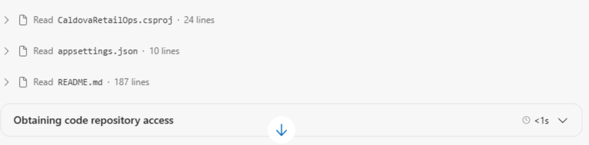

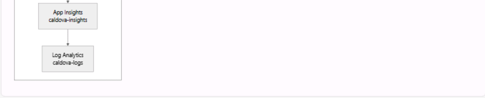

The diagram capture shows its telemetry branch, not the complete diagram.

### 2. Reproduce and repair search

The original live deployment did not reproduce the written scenario: search worked, and the old `/YSOD.aspx` availability URL returned 404. Facilitator preparation added the real future-date fault and removed the unused `BreakMyWebApp` setting. Those writes and their approval delays are **not learner debug time**.

The original debug wording produced an undeployed PR whose null guard would return an empty result. It was not merged or accepted as recovery. A fresh trial used:

> Product search fails with HTTP 500, but browsing works. Find out why, fix the running app, and check that searching for jacket returns products.

The agent proposed restoring `Catalog__AsOfDate` from `2026-12-15` to `2026-10-25` on the assigned app. After reviewing the exact target, subscription, and command, the change was approved through the existing platform gate. Rollback was the previous setting value. Search then returned real jacket products.

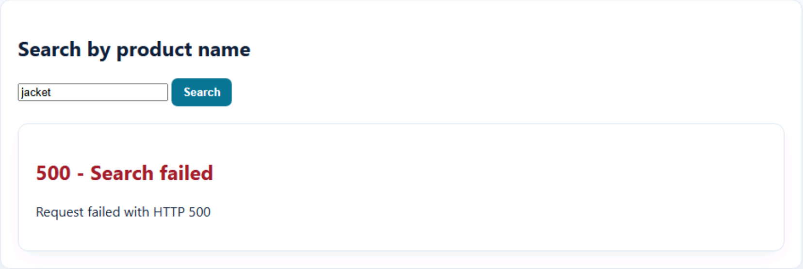

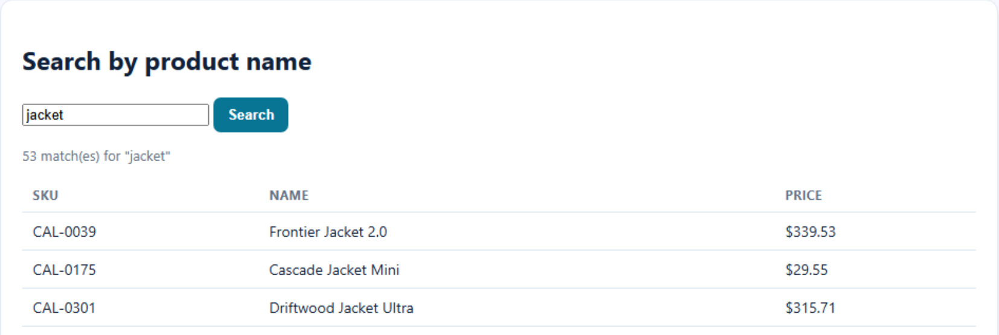

Direct checks used the **actual JSON catalog endpoint** `/api/search?page=1`, not `/api/products`. The latter returns the SPA HTML fallback with HTTP 200 and therefore is not API-success evidence.

### 3. Inspect cost automation and its deliverable

Created **Weekly Caldova cost review** through chat. The task displayed **Weekly on Monday at 2:00 AM**; the summary did not show a timezone. Exactly one manual run was triggered with **Run task now**.

An immediate **Success** status was not treated as completed analysis: the execution thread and attachment were checked separately. Findings included right-sizing and estimated savings, with no resource changes approved. The agent's monetary estimates are not independently verified prices or actual billed costs.

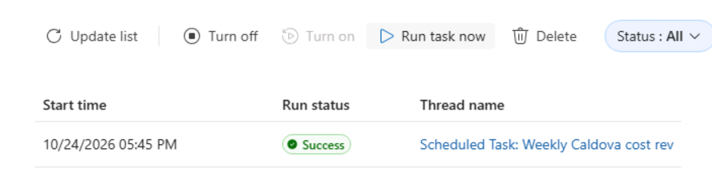

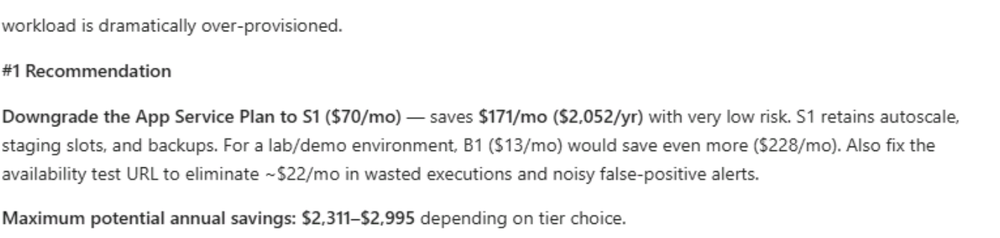

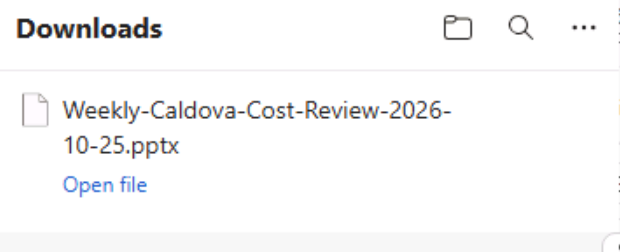

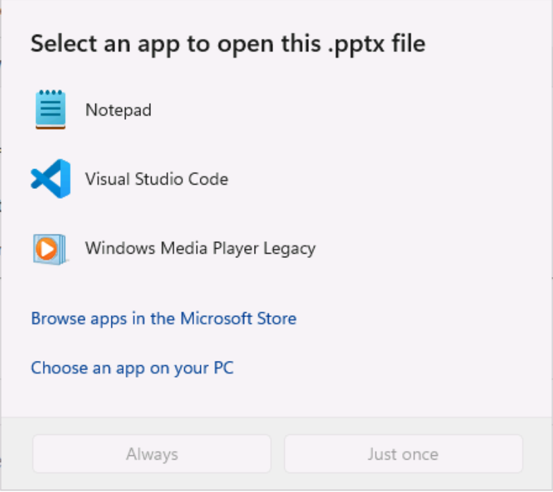

The file was `Weekly-Caldova-Cost-Review-2026-10-25.pptx`. Download is verified; slide-level visual quality and slide-reading time are not. No Office installation or permission expansion was attempted.

### 4. Inspect the live report, not just its creation status

The initial save waited on **Allow once** for `SaveReport` and one read-only resource-log query tool. The first generated layout put KPIs above the graph. A correction produced v2; comparing v1 with the current version verified the change.

The exact optional prompt, "Group the dependency graph by service and make unhealthy components stand out.", produced v3. The current graph grouped components and used distinct unhealthy styling. Traffic/response-time charts, requested/failing URL tables, and country/region data were inspected.

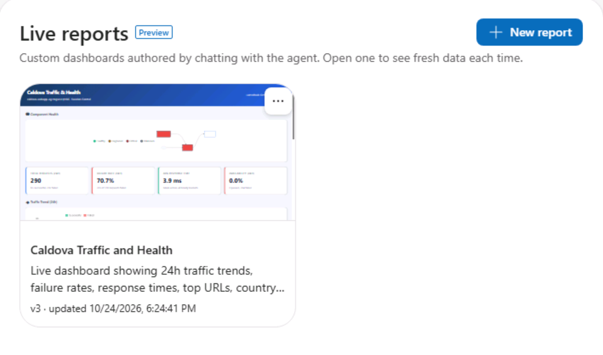

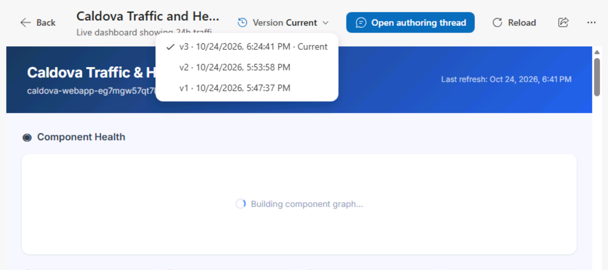

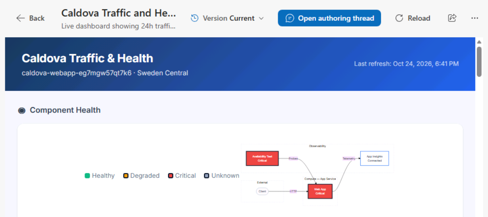

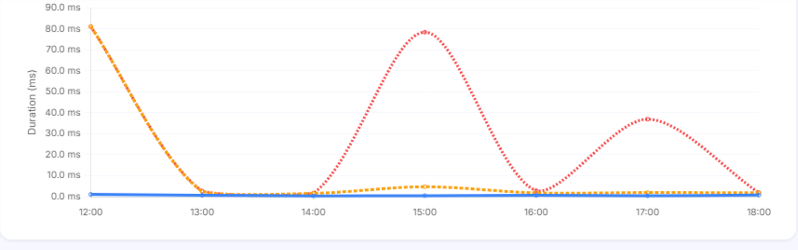

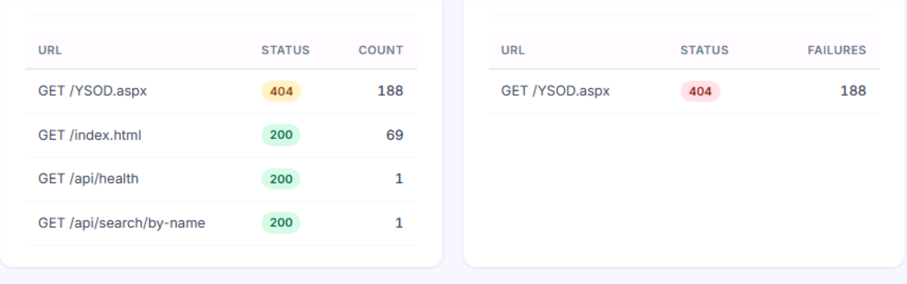

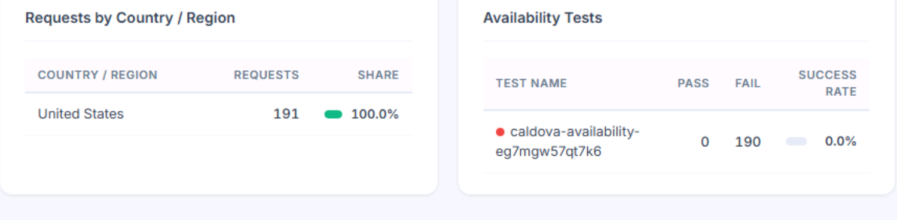

Historical traffic was dominated by old `/YSOD.aspx` 404 probes. The last-24-hour report therefore remained red after fresh search requests recovered. Historical failure metrics do not establish that the current repair failed. The graph is an authored view over connected data, not independent proof that every dependency is healthy.

### 5. Complete the separate optional Health check change

Reviewed the successful endpoint, assigned target, restart/single-instance impact, and rollback to an empty Health check path. Both the conversational confirmation and the platform's exact write approval were exercised. The completed operation returned `healthCheckPath: /api/health`.

## Instruction gaps and disposition

| Gap | Evidence / consequence | Disposition |
| --- | --- | --- |
| Seeded deployment did not match product-search instructions | Original setting was unused; old probe returned 404 | Versioned and hosted templates changed in exactly three variables. The real deployed package was validated, and the current app was seeded/repaired through guarded writes. The existing probe update completed after the timed trial. A fresh lab deployment is still untested. |
| A "fix" created only an undeployed PR with empty-result behavior | First debug trial did not restore live search | Revised the single natural prompt to require a running-app fix and jacket products. Added PR-versus-deployment and nonempty-result guidance at the end. |
| Status labels can precede deliverables | Cost run showed Success before the PPTX was verified | Added execution-thread and attachment checks. Do not rerun a task just because a deliverable is not yet visible. |
| The VM cannot open PPTX files | Windows offered Notepad, VS Code, and Media Player | Recorded as a viewing gap. Supply an approved viewer/preview before a slide-review exercise is considered complete. |
| Empty report gallery hid a pending approval | `SaveReport` waited while other work continued | Added a reminder to check the authoring thread for questions/approvals while multitasking. Kept read-only scope and one-time approval. |
| First report ignored graph-first ordering | v1 had KPIs first | Corrected and compared saved versions. Keep visual acceptance checks rather than trusting the generated summary. |
| Resuming setup did not open the existing onboarding thread | **Done and go to agent** returned to New chat in this resumed session | Main text no longer promises automatic opening. Existing **Search Threads > get to know** guidance remains at the end. Fresh-user behavior is not certified by this resumed run. |
| Browser automation and actual user work differ | Stale send/navigation coordinates, focus retries, and clipped approvals | Corrections retained in the CSV. These are operator overhead, not service latency or evidence that a human would require the same retries. |
| HTTP 200 was an insufficient browsing proxy | `/api/products` returned HTML | Corrected verification to `/api/search?page=1`, parsed product counts, and checked the customer UI. |
| Sharing was only partially exercised | **Copy link to report** clicked without granting access | Control invocation verified; link reopening and recipient-access behavior remain unverified. |
| Fresh setup and one-click VM launching remain unmeasured | Existing authenticated session reused | Deferred rather than blocking the other exercises. Manual use of the actual app URL in the VM worked. Do not reset a working lab to manufacture a timing. |
| Other teams' pages are incomplete | Modernization/ARM content is not a measured part of this SRE rehearsal | Preserve their content/placeholders; do not certify total event fit or invent their exercises. |
| Native Copy & Type Text is asynchronous | T225 captured only part of the prompt; T226 confirmed the full text without submission | Added a short reminder in the compiled guidance to keep the VM field focused until typing finishes before Send/Enter. The early partial capture is not a failed prompt or a measured completion latency. |
| Browser refresh required confirmation and a VM unlock | Initial F5 paused at **Reload site?**; completed refresh reconnected to a Windows lock screen | Confirmed the normal browser reload, unlocked the same session through the native runtime credential control, and verified the revised learner rendering. No new lab, VM reset, credential extraction, or permission change. |

## Scenario validation and publication

The exact deployed `webapp.zip` was separately validated locally with .NET 8. With the future catalog date, health and browsing were 200 while product search was 500. With the corrected date, all were 200. The isolated checks took approximately **1.93 seconds** and **0.64 seconds**, including local startup; they are not live-agent recovery or learner timings.

Only these deployment variables changed in `Caldova-WebAppP1v3-with-SREAgent-MI.json`:

| Variable | Revised value |
| --- | --- |
| `faultSettingName` | `Catalog__AsOfDate` |
| `faultSettingValue` | `2026-12-15` |
| `availabilityPath` | `/api/search/by-name?name=jacket` |

Managed identity, RBAC, agent safeguards, and other resources were not changed by this source revision. Existing-instance repair does not update future lab deployments.

Hosted **cloud template 6969** was subsequently updated through its supported editor. **Used By (1)** was followed and verified as PREL38 profile **224911** before editing. An official rollback download was taken, the source editor was compared with it, only the three variable values were replaced, and a required change note was supplied. A fresh official download confirmed the exact intended result with no other template changes at **02:09:33 UTC**. Before SHA256: `ea56aac264c463a3918c7e283a923d482ac332abf9b79202dde170530899b5fb`; after SHA256: `c2c973a2b433773d1711b882e79d55d62372b5f15c72fa4a1002f11806a07466`. This verifies persistence, not a new lab deployment.

The revised instructions were saved to **PREL38 profile 224911 / instruction set 359549**. An official post-save export matched the converted source exactly: **four native pages, seven chat prompts, and 47 hosted images**. All 44 previously hosted images were preserved byte-for-byte. The original **480-minute profile duration** was preserved; it is not the 45-minute SRE allowance.

Private rollback exports were retained. Before-publication ZIP SHA256: `1c6433865e4d2775c635950927fcc627c2367f03855b70d7a12530b0417f7e49`. After-publication ZIP SHA256: `317634051970e10a5741b5c08ed3f801707040ce3b05989958dd870cd14ed1bb`. Publication does not mean that a currently open client has refreshed its cached instructions; learner rendering and native input must be checked separately.

The existing learner client was then genuinely refreshed after accepting its normal **Reload site?** confirmation. It displayed the revised debug wording, all **seven images**, native **Copy & Type Text** controls instead of the old fenced-code controls, and **no visible authoring/duration/screenshot-placeholder warnings**. Its Windows session required an unlock; the native runtime VM password control worked without extracting or logging the credential. Azure/browser state and the existing thread were preserved.

The subsequent one-sentence typing reminder was saved and verified through another official export at **02:14:56 UTC**. The persisted source matched exactly, all **47 image files remained byte-identical**, and page/prompt counts and profile duration were unchanged. Latest export SHA256: `3b5410860c796667ac7485eddc7584a361cbf43e488fd3ac9abf6eaa2493b8d0`. This final text-only reminder was export-verified after the core learner rendering/native-input test.

The configuration prompt's actual native button was exercised with the VM chat input focused. The complete sentence appeared in that input; it was **not submitted**, avoiding a duplicate request. The typing call returned before all characters appeared, so its invocation duration is not the full typing duration.

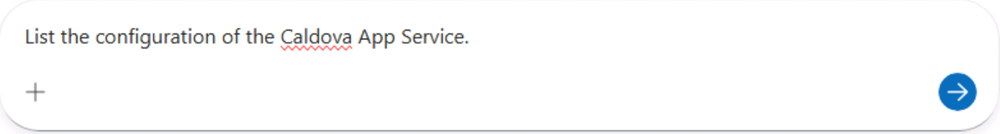

Final independent HTTP checks at **02:14:57 UTC** still returned health 200, search 200 with 53 total jacket matches and 20 matching product names, and catalog 200 with 2,000 total products and 20 returned rows.

Public screenshots are crops of actual captures, not mockups. Their manifest records capture UTC, source basename/hash, crop coordinates, and final hash. Full per-action screenshots and exports remain private because they can contain account details, credentials, or browser state. The immutable original instruction/media snapshots were not altered.

## Options to discuss before changing scope

| Option | Benefit / tradeoff |
| --- | --- |
| Start cost-task and report generation immediately after their Azure/log prerequisites are ready | Overlaps the observed long waits with onboarding, configuration, and debugging. This was the execution strategy here, but the main guide has not yet been reordered. |
| Keep onboarding conversational review to roughly 3-5 minutes | Preserves the app/architecture learning goal without repeatedly reading every generated section. Do not add another discovery exercise. |
| Keep Health check and report refinement optional | Saves an estimated 2-4 active minutes plus approval/revisit time; neither is necessary to prove search recovery. |
| Keep cost automation required but defer deep slide review until a viewer exists | Preserves scheduling, forecast, savings, and artifact checks without pretending the deck can currently be reviewed in this VM. |
| Make detailed geography/URL analysis optional while retaining graph, key metrics, versions, and sharing | Reduces report-reading time, but also reduces telemetry exploration. No scope reduction has been applied yet. |
| Add a short scheduled-task timezone check | The observed summary omitted timezone; useful before relying on the recurring schedule. |
| Add a short current-health versus historical-failure comparison | Explains why a repaired app can coexist with a red last-24-hour report. Reuse existing evidence rather than creating another workload. |

Next planning gate: decide these PREL38 tradeoffs using the evidence, then measure a fresh-user path. **LAB720's separate 25-minute optimization/publication and Word-manual synchronization have not been performed in this phase.**
