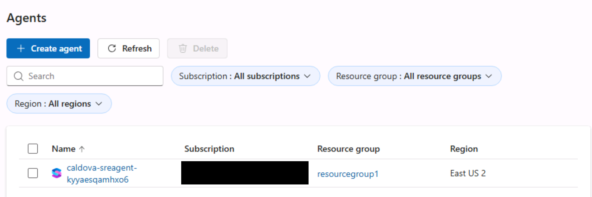
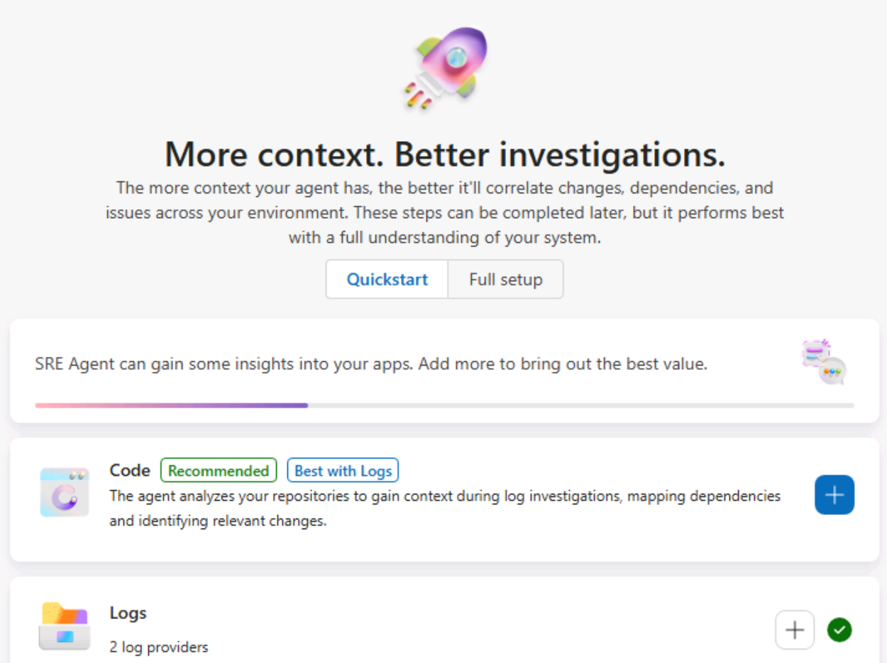
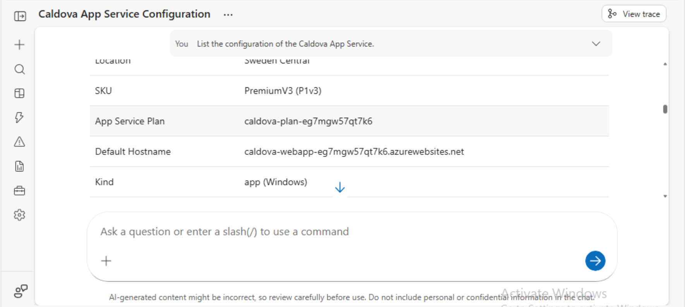
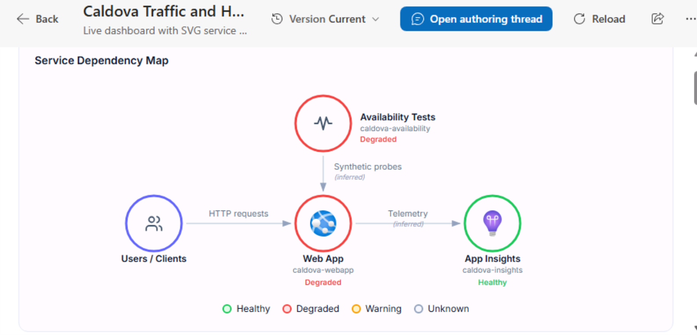
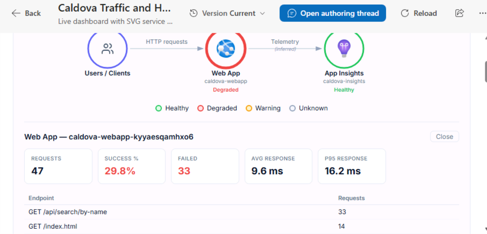
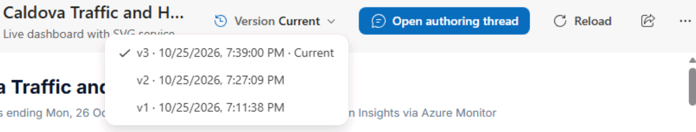
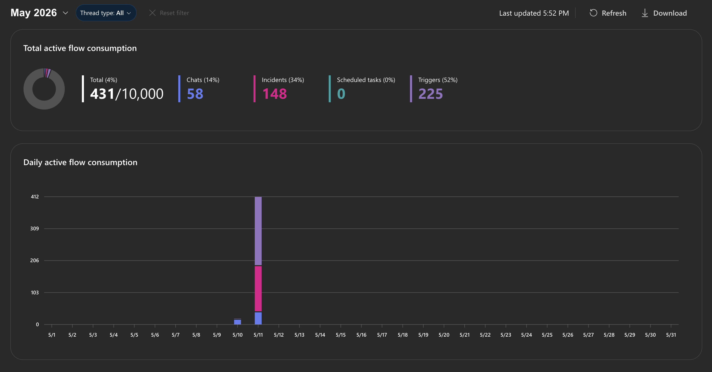
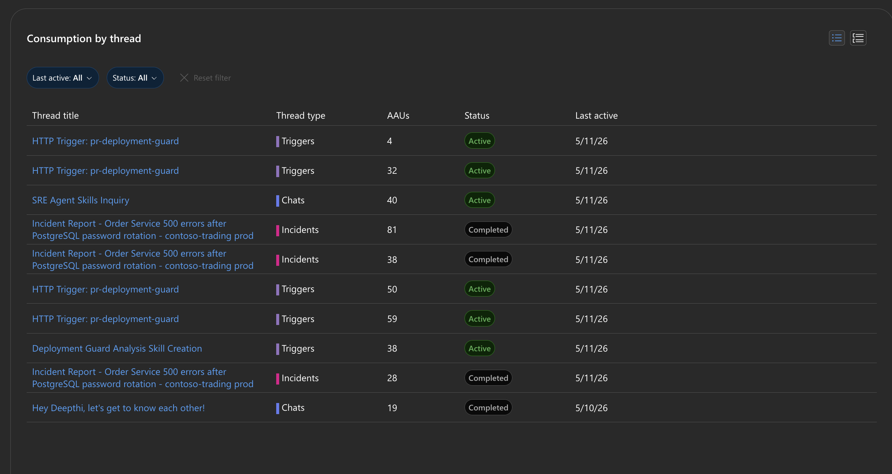

<!--
UNPUBLISHED AUTHORING DRAFT - PREL38, profile 224911, instruction set 359549.
Original instructions and media: backups/2026-10-24/PREL38/.
Modernization and ARM/Azure Copilot owners must review their pages before publication.
Setup screenshots were captured in PREL38; remaining placeholders are intentional.
Publish manually through the running lab's Edit Instructions > Code editor.
Do not enable GitHub sync or change Resources, themes, infrastructure or permissions.
-->

# Start

Prepare the lab GitHub account below. VM access and Azure sign-in details are already provided in **Resources**. Open SRE Agent when you reach exercise 2 of the **SRE Agent** module.

> [!Note] Need help? See **Additional guidance** at the end, grouped by section, or ask the facilitator.

## GitHub and Copilot

**Goal:** Sign in to the lab GitHub account and enable Copilot in VS Code. Open all pages inside the VM.

For the URL below, copy/paste or type it in the VM browser, or select the address bar **inside the VM** and click the URL to type automatically.

1. Navigate at +++https://github.com/enterprises/skillable-events/sso+++ and login with the same Azure credentials
2. Keep login page from SSO portal above open in browser, open VS Code
3. Click "Signin" in VSCode GitHub Copilot and select "Continue with Github login"
4. authenticate profile through SSO portal and GHE is now active in their VS Code instance

<!-- START-04: Enterprise SSO and VS Code GitHub sign-in; exclude credentials. -->

Select **Next** to continue to Modernization.

===

# Modernization

<!-- The Modernization owner must supply this exercise. Preserve any newer live content. -->

Use the same VM and lab credentials from Start.

Follow the facilitator's instructions for this module.

Select **Next** to continue to ARM/Azure Copilot.

===

# ARM/Azure Copilot

## Install the ARM MCP server

**Goal:** Connect GitHub Copilot to the lab's Azure environment.

For the URL below, copy/paste or type it in the VM browser, or select the address bar **inside the VM** and click the URL to type automatically.

1. In edge, navigate to +++https://aka.ms/JoinARMMCP+++, this will open up VSCode
2. Click "Install"
3. You will get automatically prompted to authenticate, do so with the same Azure credentials used previous!

Now you can use the VSCode GitHub Copilot chat to ask any questions about your Azure environment!

<!-- ARM-01: ARM MCP installation and authentication; exclude credentials. -->

<!-- ARM MCP section STEVEN TODO
The ARM/Azure Copilot owner must supply the remaining exercises. -->

Select **Next** to continue to SRE Agent, the final module.

===

# SRE Agent

## Welcome to Caldova operations

Act as the on-call engineer for Caldova Retail Co., a storefront and operations app running on Azure App Service. Understand the app, investigate a customer-visible search failure, verify recovery, automate recurring work, and build interactive operational views.

Use the assigned `caldova-sreagent-<suffix>`. The Web App, resource group, and telemetry resources may also have generated suffixes. Whenever this guide says **Caldova Web App**, use the full actual name in your lab; do not type `<suffix>` or assume a fixed example name.

## What you will accomplish

1. Start a GitHub import in the background.
2. Open the assigned SRE Agent and its context wizard.
3. Review the configured resource group and connected log sources in Quickstart, without changing them.
4. Connect the completed imported repository to the agent.
5. Review the app summary, architecture diagram, and health findings in Getting started.
6. Inspect the App Service configuration and save the website URL.
7. Investigate the product-search failure and verify recovery.
8. Schedule a weekly cost review with forecasting, savings recommendations, and an HTML slide deck.
9. Create a live report with an Azure-icon dependency-health graph, interactive views, versions, and sharing.
10. Review workflow consumption and plan the agent's active-flow AAU budget.
11. Optionally explore the Agent Canvas, skills, custom agents, integrations, and triggers without creating anything.

**Keep work moving:** Imports, agent replies, task creation, report authoring, and scheduled runs can take several minutes. Answer pending questions or approvals, then continue an independent exercise instead of waiting. Return before a dependent step, such as connecting the imported repository or searching the website. Do not submit duplicate requests.

## 1. Start the GitHub import in the background

**Goal:** Create your own repository copy while you review the agent's context.

Your private copy lets the agent inspect the application's code and propose changes against your lab repository rather than the shared source.

1. Use the **GitHub Enterprise (GHE) lab account** configured in **Start > GitHub and Copilot**, not a personal GitHub account. If needed, complete those sign-in steps in the VM browser first.
2. Select the browser address bar **inside the VM**. Copy/paste or type +++https://github.com/new/import+++, or click it to type automatically. Press **Enter inside the VM**.
3. Select **The URL for your source repository\*** field **inside the VM**. Copy/paste or type the URL below, or click it to type automatically:

+++https://github.com/puneetg1983/caldova-ignite-authoring.git+++

4. Under **Owner**, select the **same GHE lab account**. Set **Repository Name** to `caldova-ignite-authoring` and visibility to **Private**.
5. Select **Begin import**, leave the status tab open, and continue to exercise 2 **without waiting**.

## 2. Open Azure SRE Agent

**Goal:** Select the agent assigned to your lab and see how its context is assembled.

The resource list identifies which agent you are opening. Its context wizard connects the Azure scope, telemetry, and code that ground its answers; this is not a new-agent creation exercise.

1. Open a new tab in **Microsoft Edge inside the lab VM** and click its address bar. Copy/paste or type the URL below, or click it to type automatically:

+++https://sre.azure.com+++

2. Press **Enter inside the VM**, then select **Sign in**. If already signed in with the lab Azure account, continue to agent selection.
3. Use the **Azure account** in **Resources > Azure Portal**, not the VM account. At **Temporary Access Pass**, use the **TAP** control in Resources.
4. In the SRE Agent resource list, select your assigned `caldova-sreagent-<suffix>` using its full actual name. Reuse this agent throughout the lab; do not create another.

5. On **More context. Better investigations.**, keep **Quickstart** selected and the **context wizard** open. Review resources and connect the imported repository in the next exercises before selecting **Done and go to agent**.

## 3. Review Azure resources and telemetry before connecting GitHub

**Goal:** Understand which resource group and log sources the agent uses.

Azure resource scope tells the agent what it may inspect; connected logs provide the evidence for health, traffic, and failure analysis. Reviewing both helps explain the answers you will see later.

After sign-in, you should see the **context wizard**. If not, follow **Additional guidance > Review Azure resources and telemetry** at the end to open it.

Stay on **Quickstart** in the **context wizard**. GitHub is **not connected yet**. You will connect the imported repository later in this section.

1. Under **Azure resources**, click **Show details**. Review the configured **Resource group**. Leave it unchanged.
2. Under **Logs**, click **Show details**. Confirm **Application Insights** and **Log Analytics** both show **Connected**.

> [!Note] **Optional - explore connection options**
>
> Click **+** under **Azure resources** to see how you could connect a management group, subscription, or another resource group. Close or cancel without adding anything.
>
> Click **+** under **Logs** to explore the available log connectors. Close or cancel without adding anything.

Continue to **Connect the imported repository**.

## 4. Connect the imported repository

**Goal:** Connect your imported copy so the agent can investigate the application source.

Code context lets the agent relate runtime errors to their implementation and propose a fix instead of relying only on telemetry.

1. Confirm the GitHub import is complete and its source files are visible. Copy the imported repository's URL, not the original source URL.
2. In the **same context wizard**, under **Code**, click **+**. Select **GitHub** and paste your URL into **Repository URL**.
3. Scroll to **Connection method**. Keep **OAuth**, then click **Sign in to GitHub**. Confirm the **lab GitHub account**, review access, and click **Authorize Azure-SRE-Agent**. When **Connected to GitHub** appears, click **Next**.
4. Under **Add repositories**, confirm your imported repository's URL, then click **Save**.
5. Under **Code**, click **Show details** and confirm the imported repository appears.

Your repository URL should look like `https://github.com/User1-12345678_events/caldova-ignite-authoring`. Replace the example username with your actual lab GitHub username; do not use the original `puneetg1983` repository URL.

## 5. Review the Getting started thread

> [!Note] Spend up to 5 minutes here, then continue to **Inquire and configure Web App**. If the agent is still processing, continue and return later.

**Goal:** Understand what Caldova does and how its Azure resources fit together.

Use this introduction to build an application mental model before making operational decisions. Compare the agent's summary with its architecture and health evidence.

1. In the context wizard, click **Done and go to agent**, then review your **Getting started** thread.
2. Answer any open questions from the agent, then review the application summary, architecture diagram, and health findings.
3. Chat with it to understand the app better. Select the chat box **inside the VM**. Copy/paste or type the prompt below, or click it to type automatically:

++++What is this app about, and what can customers do with it?++++

*Example from an earlier lab session; your thread title and generated answers may differ.*

## 6. Inquire and configure Web App

**Goal:** Inspect and understand the assigned App Service configuration.

Knowing the hosting settings and the actual website address helps you distinguish configuration choices from application-code failures and gives you the starting point for the search exercise.

1. Select **New chat** to start a separate configuration thread, not the Getting started thread. Select the message box **inside the VM**. Copy/paste or type the prompt below, or click it to type automatically:

++++List the configuration of the Caldova App Service and provide the full HTTPS link to its website.++++

2. Send the message, review the configuration, and ask questions about any unfamiliar settings. Keep this configuration thread for the optional Health check exercise.
3. Open the website link in a new **VM browser** tab and confirm the app loads. **Bookmark the page or copy the full URL for the next exercise.** Keep the SRE Agent tab open.

The reply can take time. If it is still running, start the independent scheduled-task or live-report exercise, then return for the website link before debugging.

### Optional: Explore App Service Health check

**Goal:** Understand endpoint monitoring separately from product-search recovery, without changing settings.

In the same configuration conversation, select the message box **inside the VM**. Copy/paste or type the prompt below, or click it to type automatically:

++++Explain the Caldova App Service Health check setting and how /api/health could be used. Compare it with checking product search. Inspect only; do not change any settings.++++

Review the current setting and the explanation. A working `/api/health` does not prove that product search works. Do not approve a configuration write for this optional exploration.

## 7. Debug the product-search failure

**Goal:** Investigate the search problem, fix it, and confirm customer-visible recovery.

This exercise connects a real customer symptom with telemetry, code, and a verified running-app fix. A proposed patch is not the outcome: customers must be able to find products again.

1. Open your bookmarked website in the **VM browser**, or select the address bar in a new tab and paste or type the full URL copied during **Inquire and configure Web App**, then press **Enter inside the VM**.
2. Select **Catalog** and confirm browsing works. Under **Search by product name**, enter `jacket` and click **Search**. Observe **500 - Search failed**.

3. Return to the SRE Agent tab and select **New chat**. Select the message box **inside the VM**. Copy/paste or type the prompt below, or click it to type automatically:

++++Product search fails with HTTP 500, but browsing works. Find out why, fix the running app, and check that searching for jacket returns products.++++

4. Send the message, follow the investigation, and answer the agent's questions.
5. Return to the app tab and repeat the same `jacket` search. Confirm matching products appear and catalog browsing still works.

Investigation and deployment can take time. After answering any pending questions or approvals, continue to the independent scheduled-task or live-report exercise and return to verify recovery. Do not declare success while the running app still fails.

## 8. Schedule a weekly cost review

**Goal:** Use chat to automate cost analysis, forecasting, and savings recommendations.

SRE Agent is not just for investigating and fixing incidents. **Scheduled tasks** turn recurring work into automatic flows: NSG-rule and RBAC-access audits, CVE and vulnerability reviews where security inventory is connected, FinOps reviews, anomaly detection, operational reporting, and proposed code changes or pull requests with the appropriate permissions and human review. In this exercise, automate a read-only weekly cost review rather than changing resources.

> [!Note] This lab was just deployed, so little cost history may be available. That reflects the age of the lab, not a limitation of the agent. Forecasts should state their assumptions.

1. In SRE Agent, select **New chat**. Select the message box **inside the VM**. Copy/paste or type the prompt below, or click it to type automatically:

++++Create a weekly scheduled task called "Weekly Caldova cost review" and run it once now. Review current Azure costs, forecast next month, and recommend savings. Produce a self-contained HTML slide deck with charts, tables, and clear visuals for cost drivers, forecasts, and savings. Use available data, label estimates and assumptions, and do not change any resources.++++

2. Send the message and answer **any questions from the agent**. Task creation can take several minutes. **Don't wait for completion**: start the live-report exercise and return to this thread later.
3. **Only after the agent confirms the scheduled task has been created**, select **Automation > Weekly Caldova cost review**. Check its schedule and latest run status. If no run has started or is pending, select **Run task now** once; do not duplicate an agent-triggered run.

4. **Don't wait for completion.** Scroll to **Create a live traffic and health report** below and continue.
5. After that activity, return to **Automation > Weekly Caldova cost review**. Open its latest execution thread, review the findings, and open the HTML slide deck in the VM browser. The run has its own thread, separate from the conversation that created the task.

## 9. Create a live traffic and health report

**Goal:** Visualize dependencies and health, inspect traffic, and explore report versions and sharing.

**Live Reports are a UI for AI:** describe the operational view you need, then inspect and refine dashboard-like views through the same agent. This brings dependency maps, telemetry, reporting, and supported interactions into one workflow instead of requiring a separate dashboard-building exercise. Interactivity depends on the report's available tools and components; do not assume every chart or node is clickable.

1. In the left navigation, select **Live reports > + New report**.
2. When the agent asks what report you want, select **Enter a custom response** **inside the VM**. Copy/paste or type the prompt below, or click it to type automatically:

++++Create a live report called "Caldova Traffic and Health" using 24 hours of connected telemetry. Before the metric cards, draw a dependency graph using Azure service SVG icons inside circular health-colored rings, not text-only rectangles. Include a legend; label unknown health and inferred connections. Where supported, make nodes clickable for service health and metrics/logs; do not invent links. Below, show request counts, failure rate, response times, top requested/failing URLs, and geography where available. Use interactive charts and filters where supported, use a responsive layout, label missing data, and keep it read-only.++++

3. Click the arrow beside your response and answer any further questions. Review the report-saving approval and allow only the expected read-only telemetry tools.
4. Report authoring and saving can take several minutes. **Don't wait for completion.** Return to the scheduled task's creation thread; if it confirms creation, check the task under **Automation**. Finish other pending activities or continue to **Explore agent capabilities (optional)**, then return.
5. Return later through **Live reports > Caldova Traffic and Health** once the report is saved. Review the dependency graph first, then the charts and tables.
6. Review the Azure service icons, health rings, and legend. If a graph node offers a drill-down, click it and inspect the service details or related telemetry, then return to the report. Try any available chart filters. If those interactions are unavailable, note that limitation; do not treat a decorative node as a working link. If the layout differs from your request, use **Open authoring thread** to ask for a correction to the existing report, not a duplicate.

   A node's details may open **below the graph**; scroll inside the report to see them. These panels can summarize the report's existing log-query results rather than make a new request. Read health rings as telemetry-based indicators, not a separate Azure Resource Health check.

7. Open the **version picker** to inspect saved versions. If an earlier version exists, compare it, then return to the current version. Versions preserve layout and configuration, not historical telemetry.
8. Select the share icon at the upper right (**Copy link to report**). Recipients must already have access to the agent; sharing the link does not grant access.

These examples are from a targeted lab check. Your telemetry, resource names, health, and saved versions will differ. The Web App details summarize observed requests; the Application Insights node describes telemetry collection, not whether the monitored app is healthy.

## 10. Review agent consumption and the AAU budget

**Goal:** Plan an agent-workflow budget using Azure Agent Units (AAUs) and the evidence from individual execution threads.

This is a **budgeting exercise, not another Azure resource-cost analysis**. Set an active-flow allowance in advance, decide which workflows deserve the agent's attention, then inspect what those workflows actually consumed. Start with a small set of high-value workflows, gain confidence in their outcomes and AAU usage, and add more workflows deliberately. Compare observed consumption per completed run and intended frequency when planning; do not assume one run predicts every future run.

1. In the left navigation, select **Settings > Agent consumption**. Select the current month and review **Total active flow consumption** and **Daily active flow consumption**.

2. In **Consumption by thread**, find your configuration, search investigation, cost-review execution, and report-authoring threads where listed. Compare their AAUs and status; active threads can still consume more.
3. Click a thread title to open its conversation. Review the agent's steps, tool calls, approvals, and result. Repeat for the weekly cost task's execution thread, not just the chat that created the schedule.

*AAU screenshots: Microsoft, [Monitor agent usage](https://learn.microsoft.com/en-us/azure/sre-agent/monitor-agent-usage), [CC BY 4.0](https://creativecommons.org/licenses/by/4.0/), reproduced unchanged. These are documentation examples, not measurements from this lab.*

4. Return to **Agent consumption**. Use the **Chats** and **Scheduled tasks** cards to compare those types, then clear the filter. Select **Refresh** to update usage; select **Download** if you want a CSV of the currently filtered threads.
5. Under **Monthly AAU limit**, select **Change AAU allocation** and inspect the active-flow allowance. Record a proposed limit, then close without saving so the remaining exercises can continue.

The **active-flow** limit controls the agent's processing allowance, not the cost of the Caldova Azure resources. The fixed **always-on** charge is separate and continues even when active flow is stopped or its limit is reached.

Choose one workflow you would start with and one you would add later. Record why each merits the agent's attention and how its execution-thread consumption would affect your planned budget. Do not save a budget change in this lab.

## 11. Explore agent capabilities (optional)

**Goal:** Understand how to extend and govern an agent, and choose where these capabilities would help your own operations.

This is an **exploration-only** exercise. Inspect existing views and examples; do not create or save skills, custom agents, connectors, policies, hooks, incident connections, response plans, or HTTP triggers. No additional credentials, permissions, test alerts, or outages are needed.

### Explore Agent Canvas and Skill Builder

1. Open **Build + setup** (**Builder** in the earlier navigation) and explore **Agent Canvas**, if available. Inspect the existing agent and its capabilities. If a capability is not available in this lab, read its purpose below and continue.
2. Explore **Skills** and the skill-building view, if available. Read an existing example or the description; leave any draft without saving.
3. Explore the available custom-agent, connector, tool, policy, and hook views without changing settings. Use the examples below to decide which capability fits a workflow.

| Capability | Why you would use it | Caldova example |
| --- | --- | --- |
| Skill | Reusable instructions or a runbook that the agent can load when relevant; standardizes a procedure without creating a separate specialist. | A product-search check that distinguishes browsing, health-endpoint status, and real matching search results. |
| Custom agent | A focused specialist with its own instructions and selected skills/tools, invoked deliberately or routed to by a workflow. | A read-only search-health reviewer or a FinOps reviewer with a narrow remit. |
| Connector | Gives the agent an authenticated connection to a data or service surface. | Azure telemetry, the imported GitHub repository, or an approved incident platform. |
| Tool | A specific operation the agent can perform through its available integrations; inspect its inputs and whether it reads or changes state. | Query request failures, inspect an NSG, or propose a pull request with review. |
| Policy | Constrains agent behavior and approval boundaries so useful automation stays within the intended scope. | Require human review before a deployment or RBAC change. |
| Hook | Runs configured logic at supported lifecycle points to extend or check a workflow. | Add an organization-specific pre-action check or post-action audit record where the platform supports it. |

### Explore incident management and HTTP triggers

1. Open **Incidents > Triggers + response plans**. Review any existing incident sources, filters, response plans, and autonomy settings without connecting or enabling anything.
2. Explore the **HTTP trigger** entry or documentation if available. Inspect the concept only; do not create a trigger, copy access-bearing callback URLs, or send a request.

Incident management turns incoming alerts into routed investigation workflows instead of waiting for an operator to start a chat. A response plan chooses which alerts deserve attention, which specialist handles them, and what requires approval. Narrow filters and cooldowns help avoid overlapping work and repeated AAU consumption.

An HTTP trigger lets an external system start a defined agent workflow on demand, such as requesting a deployment-readiness review from a pipeline or a compliance report from an internal portal. Scheduled tasks run by time; incident triggers react to alerts; HTTP triggers react to an explicit application request. Choose the trigger that fits the event and the agent attention you have budgeted.

## Complete

Confirm search works, review the cost findings and HTML slide deck, inspect the live report, and record which workflows you would budget for using their thread-level AAUs. Finish any optional exploration you chose. Record anything still running or blocked. Follow the facilitator's cleanup instructions; do not reset the lab or delete shared resources.

## Additional guidance

Use this section if you are stuck or need more help following an instruction, or ask the facilitator. Optional exercises are included with the main activities above, not here.

### Open Azure SRE Agent

Focus the destination field **inside the VM**. Copy/paste or type the prompt or URL, or click its text in these instructions to type automatically. For automatic typing, keep it focused until typing finishes. Then select **Send** or press **Enter** as instructed. Use **Resources > Azure Portal** for Azure sign-in details, not the VM account.

**Type Text did not work?** Type `https://sre.azure.com` manually in the VM browser's address bar, then press **Enter inside the VM**. Do not change VM settings or permissions.

**Password requested instead of TAP?** Use the Azure password in **Resources > Azure Portal**, not the VM password.

### Review Azure resources and telemetry

If the wizard is closed, go to **Operations hub > Overview > Complete setup**. Ask the facilitator if the option is absent. Review only the existing resource group; do not add broader access.

### Connect the imported repository

Do not add a duplicate connection or use a personal account. If the agent reports that indexing is still running, continue another activity and return later. If it cannot retrieve the imported source, ask the facilitator.

### Review the Getting started thread

Under **Favorites**, select **Team onboarding**. If absent, select **Search Threads**, search `get to know`, and open your lab user's greeting.

### Inquire and configure Web App

Keep Getting started for the app overview. Use **New chat** for configuration and its optional read-only Health check explanation. Bookmark or copy the website link returned by the configuration prompt for the next exercise. If it is missing or does not open, use the manual steps below.

### Debug the product-search failure

**Website link missing or not opening?** Find the actual app URL manually:

1. Open a new tab in the **VM browser** and select its address bar. Copy/paste or type the Azure Portal URL below, or click it to type automatically. Then press **Enter inside the VM**:

+++https://portal.azure.com+++

2. In Azure Portal, select **Resource groups** and open the resource group assigned to this lab, shown in **Resources**. In its resource list, open **caldova-webapp-...** with type **App Service**, not the App Service plan.
3. On the web app's **Overview** page, find **Default domain**. Select **Browse** to open the app, or copy the domain and paste or type `https://` followed by that domain into a new VM browser tab, then press **Enter inside the VM**. Bookmark the page or copy its full URL, and keep the SRE Agent tab open.

Example only: `https://caldova-webapp-<unique-suffix>.azurewebsites.net`. Your suffix will differ, and Azure may include extra regional hostname components. Use the complete **Default domain** shown for your app, not this example.

**Cannot find the web app?** Confirm Azure Portal is using the lab's Azure account and assigned subscription from **Resources**, then reopen the assigned resource group and clear resource-list filters. Look for **caldova-webapp-...** with type **App Service**. If it is absent or access is denied, ask the facilitator; do not create resources or change permissions. If the app does not open, copy its complete **Default domain** from **Overview** and try the HTTPS address in the VM browser. Do not use the example URL or another learner's hostname.

If search already works, tell the facilitator; do not break the app yourself. Verify recovery by repeating the search in the app.

A source-code pull request is not a deployment. If the running app still fails after a proposed fix, tell the agent the result and ask it to restore live search. Returning an empty result set is not recovery for the `jacket` search.

### Schedule a weekly cost review

If the task is not listed yet, return to its creation chat and answer any pending questions or approvals. Continue another activity and check again; do not create a duplicate task.

Wait for the creation thread to confirm that the task exists before looking for it under **Automation**. If creation is still running, continue an independent exercise and return later.

Select **Automation > Weekly Caldova cost review** to check its latest run. Do not start a duplicate run. Open the execution thread to verify the findings and HTML slide deck, rather than relying on the run status alone. If a run fails or the HTML attachment is missing or does not open, record the issue and ask the facilitator; do not install software or grant additional access.

### Create a live traffic and health report

If telemetry is empty, browse the app and try search, then return after another activity. Missing data or unknown dependency health does not mean the app is healthy. Ask the facilitator about connector or query errors; do not add permissions.

While working on another activity, check the report's authoring thread for pending questions or approvals. **Allow once** may be needed to save the report with its expected read-only telemetry tools; saving the report does not change Azure resources. An empty gallery does not necessarily mean generation is still running.

The 24-hour report can still include earlier failures after a fix. Verify recovery with fresh app requests rather than expecting historical failure charts to turn green immediately.

**Generic symbols instead of Azure service icons, or graph too tall?** Open the existing report's **Open authoring thread**, then select its message field **inside the VM**. Copy/paste or type the prompt below, or click it to type automatically:

++++Replace only the Web App and App Insights glyphs with these Azure SVGs inside the existing health rings. Preserve click handlers and queries. Cap graph height at 400px without distortion. Save a new version, not a new report. Web App: https://raw.githubusercontent.com/puneetg1983/caldova-ignite-authoring/b4d549a6e6d38b260cde398873ec44c5d3caf43c/skillable/instructions/images/prel38-revision/azure-app-service.svg App Insights: https://raw.githubusercontent.com/puneetg1983/caldova-ignite-authoring/b4d549a6e6d38b260cde398873ec44c5d3caf43c/skillable/instructions/images/prel38-revision/azure-application-insights.svg++++

Send the message, continue an independent activity, and return for any save approval. These original Microsoft icons are supplied unchanged under the [Azure icon terms](https://learn.microsoft.com/en-us/azure/architecture/icons/#icon-terms). Keep the health rings around the icons; do not alter their shapes.

**Clicked a node but cannot see details?** Scroll within the report, using its right-hand scrollbar if the mouse wheel does not move it. Look below the graph and legend for the service panel. If no panel or supported interaction appears, record that limitation rather than inventing a link.

### Agent consumption and budget changes

If **Agent consumption** is not offered under **Settings**, use the labelled reference screenshots to discuss workflow budgets and ask the facilitator about availability. Do not restart the agent, switch navigation modes, enable features, or change permissions to reveal the page. Record that live consumption and allocation inspection were unavailable, not that usage was zero.

Usage can lag behind the conversation. Select the correct month, clear type/day/status filters, and select **Refresh** before concluding that a thread is missing or has used no AAUs. Use thread titles and execution details to identify work; do not assume a report or scheduled task is represented only by its creation chat.

### Reference guides

The consumption and optional exploration follow the product guides below. These links explain the capabilities; creating them is not required in this lab. If a control is unavailable in your lab version, ask the facilitator rather than changing permissions.

- [Agent consumption](https://learn.microsoft.com/en-us/azure/sre-agent/monitor-agent-usage) and [AAU limits and billing](https://learn.microsoft.com/en-us/azure/sre-agent/pricing-billing#set-an-active-flow-spending-limit).
- [Create a skill](https://sre.azure.com/docs/tutorials/automation/create-skill) and [Create a custom agent](https://sre.azure.com/docs/tutorials/automation/create-subagent).
- [Connect Azure Monitor and automate incidents](https://sre.azure.com/docs/get-started/automate-incidents) and [Configure a response plan](https://sre.azure.com/docs/tutorials/agent-config/setup-response-plan).
