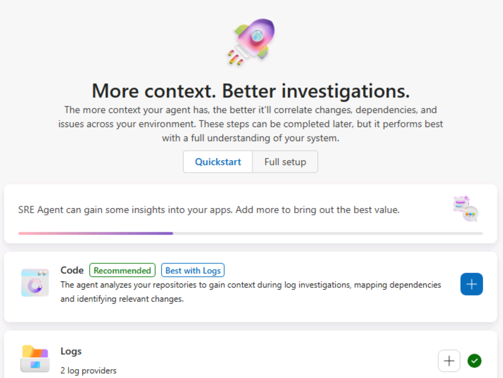
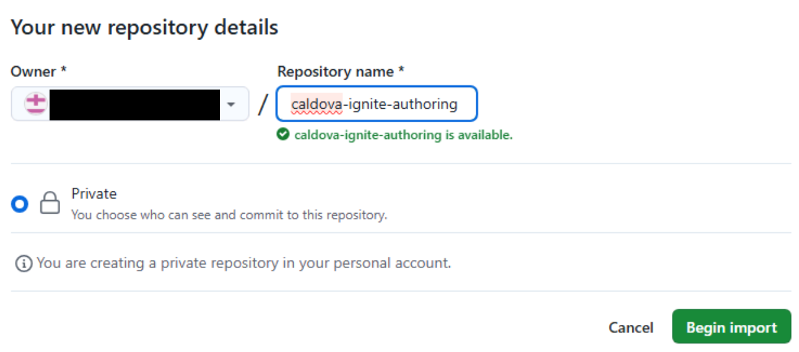
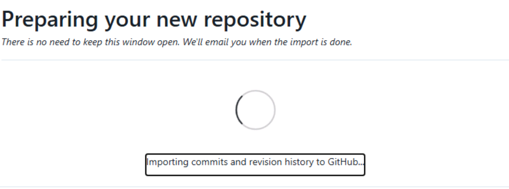
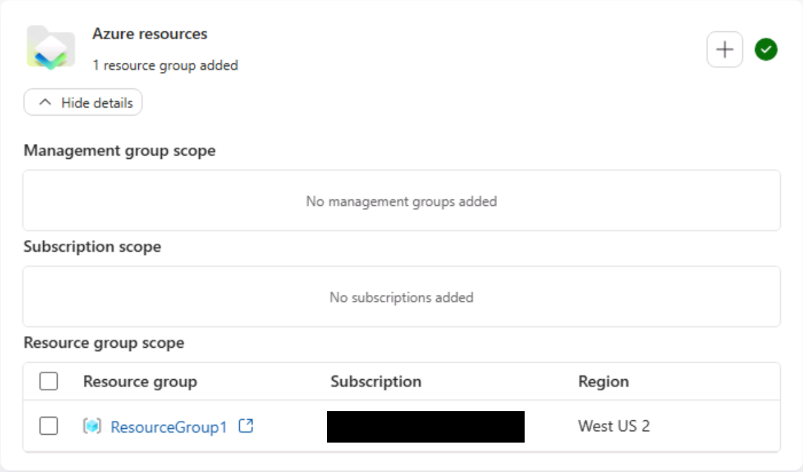
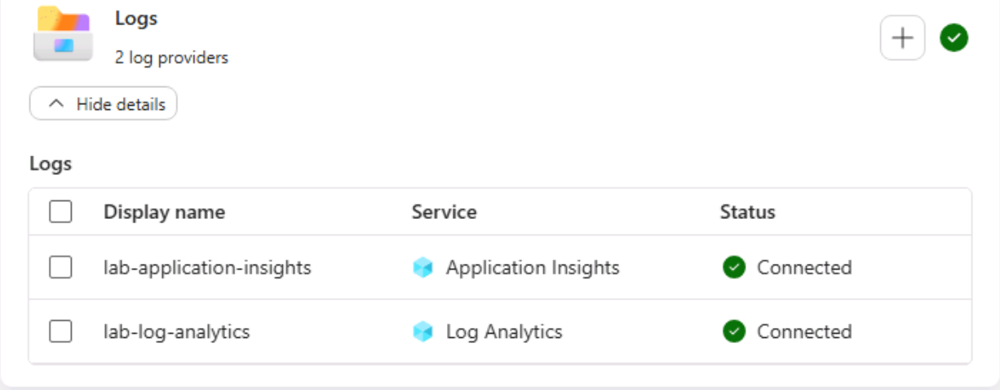
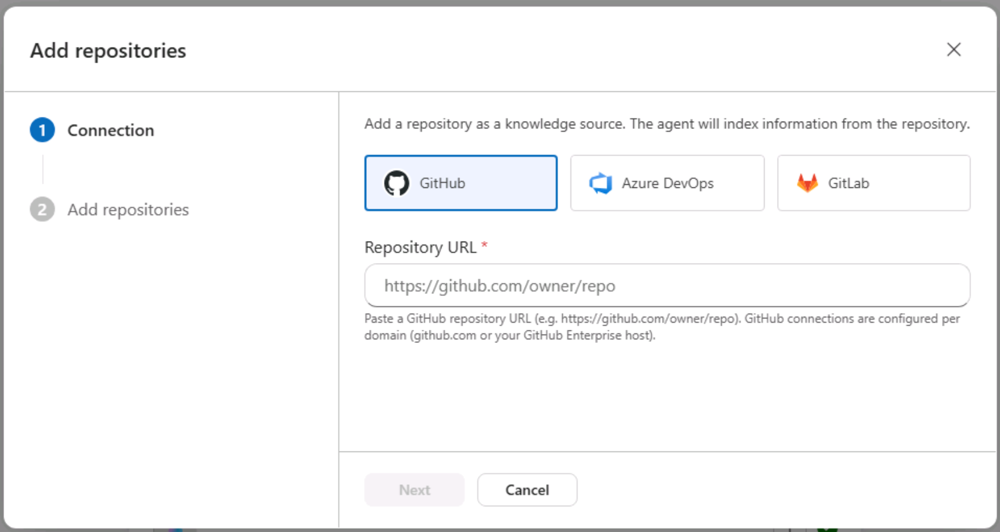
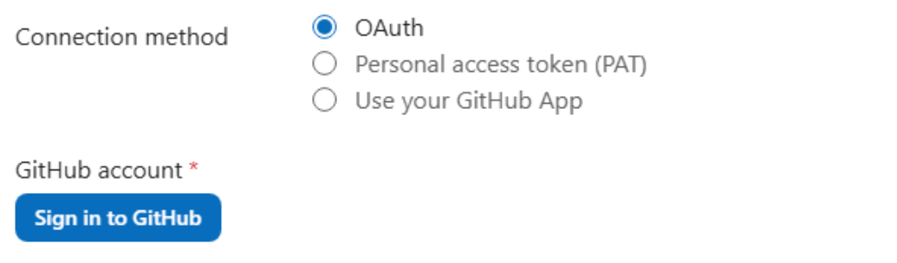
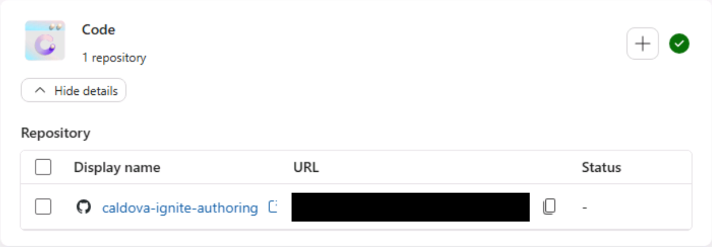
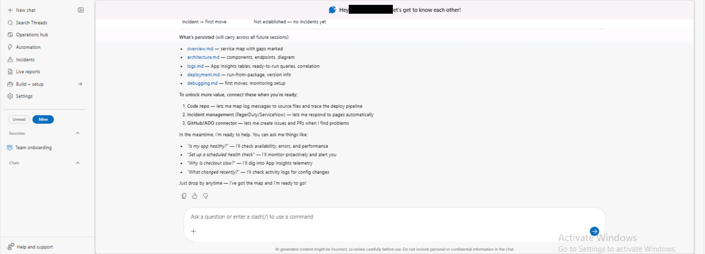
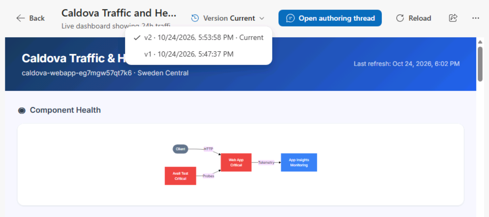

<!--
UNPUBLISHED AUTHORING DRAFT - PREL38, profile 224911, instruction set 359549.
Original instructions and media: backups/2026-10-24/PREL38/.
Modernization and ARM/Azure Copilot owners must review their pages before publication.
Setup screenshots were captured in PREL38; remaining placeholders are intentional.
Publish manually through the running lab's Edit Instructions > Code editor.
Do not enable GitHub sync or change Resources, themes, infrastructure or permissions.
-->

# Start

Open your assigned SRE Agent. VM access and Azure sign-in details are already provided in **Resources**.

> [!Note] Need help? See **Additional guidance** at the end, grouped by section, or ask the facilitator.

## 1. Open Azure SRE Agent

**Goal:** Open the SRE portal and select the agent assigned to your lab.

1. Open **Microsoft Edge inside the lab VM** and click its address bar. Use **Type Text**:

+++https://sre.azure.com+++

2. Press **Enter inside the VM**, then select **Sign in**. If already signed in with the lab Azure account, continue to agent selection.
3. Use the **Azure account** in **Resources > Azure Portal**, not the VM account. At **Temporary Access Pass**, use the **TAP** control in Resources.
4. Select your assigned `caldova-sreagent-<suffix>` using its full actual name. Reuse this agent throughout the lab; do not create another.
5. You should see **More context. Better investigations.** with **Quickstart** selected. Keep this **context wizard** open. Review configuration and connect the imported repository in the SRE Agent module before selecting **Done and go to agent**.



<!-- SRE-00: SRE sign-in and agent selection; exclude account details and credentials. -->

## GitHub and Copilot

**Goal:** Sign in to the lab GitHub account and enable Copilot in VS Code. Open all pages inside the VM.

1. Navigate at +++https://github.com/enterprises/skillable-events/sso+++ and login with the same Azure credentials
2. Keep login page from SSO portal above open in browser, open VS Code
3. Click "Signin" in VSCode GitHub Copilot and select "Continue with Github login"
4. authenticate profile through SSO portal and GHE is now active in their VS Code instance

<!-- START-04: Enterprise SSO and VS Code GitHub sign-in; exclude credentials. -->

Select **Next** to continue to Modernization.

===

# Modernization

<!-- The Modernization owner must supply this exercise. Preserve any newer live content. -->

Use the same VM and lab credentials from Start.

Follow the facilitator's instructions for this module.

Select **Next** to continue to ARM/Azure Copilot.

===

# ARM/Azure Copilot

## Install the ARM MCP server

**Goal:** Connect GitHub Copilot to the lab's Azure environment.

1. In edge, navigate to +++https://aka.ms/JoinARMMCP+++, this will open up VSCode
2. Click "Install"
3. You will get automatically prompted to authenticate, do so with the same Azure credentials used previous!

Now you can use the VSCode GitHub Copilot chat to ask any questions about your Azure environment!

<!-- ARM-01: ARM MCP installation and authentication; exclude credentials. -->

<!-- ARM MCP section STEVEN TODO
The ARM/Azure Copilot owner must supply the remaining exercises. -->

Select **Next** to continue to SRE Agent, the final module.

===

# SRE Agent

## Welcome to Caldova operations

Act as the on-call engineer for Caldova Retail Co., a storefront and operations app running on Azure App Service. Understand the app, investigate a customer-visible search failure, verify recovery, and create reusable cost and health views.

Use the assigned `caldova-sreagent-<suffix>`. The Web App, resource group, and telemetry resources may also have generated suffixes. Whenever this guide says **Caldova Web App**, use the full actual name in your lab; do not type `<suffix>` or assume a fixed example name.

## What you will accomplish

1. Start a GitHub import in the background.
2. Review the configured resource group and connected log sources in Quickstart, without changing them.
3. Connect the completed imported repository to the agent.
4. Review the app summary, architecture diagram, and health findings in Getting started.
5. Inspect the App Service configuration.
6. Investigate the product-search failure and verify recovery.
7. Schedule a weekly cost review with forecasting, savings recommendations, and a PowerPoint.
8. Create a live report with a dependency-health graph, traffic charts, versions, and sharing.
9. Review the agent's thread-level consumption and learn how to control its active-flow AAU budget.

Return to the SRE Agent tab opened on Start. Keep the **context wizard** open for the review and repository connection below.

## Start the GitHub import in the background

**Goal:** Create your own repository copy while you review the agent's context.

1. Use the **GitHub Enterprise (GHE) lab account** configured in **Start > GitHub and Copilot**, not a personal GitHub account. If needed, complete those sign-in steps in the VM browser first.
2. Focus the browser address bar inside the VM, click +++https://github.com/new/import+++, then press **Enter inside the VM**.
3. In **The URL for your source repository\***, enter:

+++https://github.com/puneetg1983/caldova-ignite-authoring.git+++

4. Under **Owner**, select the **same GHE lab account**. Set **Repository Name** to `caldova-ignite-authoring` and visibility to **Private**.
5. Select **Begin import**, leave the status tab open, and return to the SRE Agent's context wizard for the configuration review **without waiting**.





## Review Azure resources and telemetry before connecting GitHub

**Goal:** Understand which resource group and log sources the agent uses.

After sign-in, you should see the **context wizard**. If not, follow **Additional guidance > Review Azure resources and telemetry** at the end to open it.

Stay on **Quickstart** in the **context wizard**. GitHub is **not connected yet**. You will connect the imported repository later in this section.

1. Under **Azure resources**, click **Show details**. Review the configured **Resource group**. Leave it unchanged.
2. Under **Logs**, click **Show details**. Confirm **Application Insights** and **Log Analytics** both show **Connected**.





> [!Note] **Optional - explore connection options**
>
> Click **+** under **Azure resources** to see how you could connect a management group, subscription, or another resource group. Close or cancel without adding anything.
>
> Click **+** under **Logs** to explore the available log connectors. Close or cancel without adding anything.

Continue to **Connect the imported repository**.

## Connect the imported repository

**Goal:** Connect your imported copy so the agent can investigate the application source.

1. Confirm the GitHub import is complete and its source files are visible. Copy the imported repository's URL, not the original source URL.
2. In the **same context wizard**, under **Code**, click **+**. Select **GitHub** and paste your URL into **Repository URL**.
3. Scroll to **Connection method**. Keep **OAuth**, then click **Sign in to GitHub**. Confirm the **lab GitHub account**, review access, and click **Authorize Azure-SRE-Agent**. When **Connected to GitHub** appears, click **Next**.
4. Under **Add repositories**, confirm your imported repository's URL, then click **Save**.
5. Under **Code**, click **Show details** and confirm the imported repository appears. Confirm the repository connection is ready before source-code debugging.

Your repository URL should look like `https://github.com/User1-12345678_events/caldova-ignite-authoring`. Replace the example username with your actual lab GitHub username; do not use the original `puneetg1983` repository URL.







## Review the Getting started thread

> [!Note] Spend up to 5 minutes here, then continue to **Inquire and configure Web App**. If the agent is still processing, continue and return later.

**Goal:** Understand what Caldova does and how its Azure resources fit together.

1. In the context wizard, click **Done and go to agent**, then review your **Getting started** thread.
2. Answer any open questions from the agent, then review the application summary, architecture diagram, and health findings.
3. Chat with it to understand the app better. To use the example below, click the chat box **inside the VM**, then click **Copy & Type Text**:

++++What is this app about, and what can customers do with it?++++



*Example from an earlier lab session; your thread title and generated answers may differ.*

## Inquire and configure Web App

**Goal:** Inspect and understand the assigned App Service configuration.

1. Select **New chat** to start a separate configuration thread, not the Getting started thread. Click the message box and use **Copy & Type Text**:

++++List the configuration of the Caldova App Service.++++

2. Send the message, review the configuration, and ask questions about any unfamiliar settings. Keep this configuration thread for the app URL and optional Health check exercise.

The Health check configuration exercise is optional; see **Additional guidance**.

## Debug the product-search failure

**Goal:** Investigate the search problem, fix it, and confirm customer-visible recovery.

1. Confirm the repository import and connection are ready and the agent can retrieve source files.
2. Open the Caldova web app URL from the configuration response in the **VM browser**. See **Additional guidance** if the URL is missing.
3. Select **Catalog** and confirm browsing works. Under **Search by product name**, enter `jacket` and click **Search**. Observe **500 - Search failed**.


4. Return to the SRE Agent tab, select **New chat**, click the message box, and use **Copy & Type Text**:

++++Product search fails with HTTP 500, but browsing works. Find out why, fix the running app, and check that searching for jacket returns products.++++

5. Send the message, follow the investigation, and answer the agent's questions.
6. Return to the app tab and repeat the same `jacket` search. Confirm results appear and catalog browsing still works.

## Schedule a weekly cost review

**Goal:** Use chat to automate cost analysis, forecasting, and savings recommendations.

> [!Note] This lab was just deployed, so little cost history may be available. That reflects the age of the lab, not a limitation of the agent. Forecasts should state their assumptions.

1. In SRE Agent, select **New chat**. Click the message box, then use **Copy & Type Text**:

++++Create a weekly task called "Weekly Caldova cost review" and run it once now. Review current Azure costs, forecast next month, and recommend ways to save money. Create a beautiful, visually rich PowerPoint with charts, tables, and clear visuals showing cost drivers, forecasts, and potential savings. Use available data, clearly label estimates and assumptions, and don't change any resources.++++

2. Send the message and answer **any questions from the agent**.
3. In the left navigation, select **Automation**. Once **Weekly Caldova cost review** appears, open it and check its schedule and latest run status. If no run has started, select **Run task now**.


4. **Don't wait for completion.** Scroll to **Create a live traffic and health report** below and continue.
5. After that activity, return to **Automation > Weekly Caldova cost review**. Open its latest execution thread, review the findings, and open the PowerPoint attachment.

## Create a live traffic and health report

**Goal:** Visualize dependencies and health, inspect traffic, and explore report versions and sharing.

1. In the left navigation, select **Live reports > + New report**.
2. When the agent asks what report you want, click **Enter a custom response** and use **Copy & Type Text**:

++++Create a visually rich live report called "Caldova Traffic and Health" using the last 24 hours of connected telemetry. Put a dependency graph at the top, showing each component and its health. Below it, show traffic trends, request counts, failure rate, response times, top requested and failing URLs, and country/region where available. Use clear charts, tables, and health indicators. Label missing data and unknown health, and keep it read-only.++++

3. Click the arrow beside your response and answer any further questions. Review the report-saving approval and allow only the expected read-only telemetry tools.
4. **Don't wait for completion.** Select **Automation > Weekly Caldova cost review** and check its latest run. Finish other pending activities; if none remain, scroll to **Additional guidance** and try an optional activity.
5. Return later through **Live reports > Caldova Traffic and Health** once the report is saved. Review the dependency graph first, then the charts and tables.
6. Open the **version picker** to inspect saved versions. If an earlier version exists, compare it, then return to the current version. Versions preserve layout and configuration, not historical telemetry.
7. Select the share icon at the upper right (**Copy link to report**). Recipients must already have access to the agent; sharing the link does not grant access.



## Review agent consumption and the AAU budget

**Goal:** Understand which work consumed Azure Agent Units (AAUs), inspect the threads behind that work, and find the active-flow budget control.

1. In the left navigation, select **Settings > Agent consumption**. Select the current month and review **Total active flow consumption** and **Daily active flow consumption**.
2. In **Consumption by thread**, find your configuration, search investigation, cost-review execution, and report-authoring threads where listed. Compare their AAUs and status; active threads can still consume more.
3. Click a thread title to open its conversation. Review the agent's steps, tool calls, approvals, and result. Repeat for the weekly cost task's execution thread, not just the chat that created the schedule.
4. Return to **Agent consumption**. Use the **Chats** and **Scheduled tasks** cards to compare those types, then clear the filter. Select **Refresh** to update usage; select **Download** if you want a CSV of the currently filtered threads.
5. Under **Monthly AAU limit**, select **Change AAU allocation** and inspect the active-flow allowance. Record a proposed limit, then close without saving so the remaining exercises can continue. See **Additional guidance > Agent consumption and budget changes** for applying a facilitator-approved limit after the lab activities.

The **active-flow** limit controls the agent's processing allowance, not the cost of the Caldova Azure resources. The fixed **always-on** charge is separate and continues even when active flow is stopped or its limit is reached.

## Complete

Confirm search works, review the cost findings and PowerPoint, inspect the live report, and record which threads consumed AAUs. If time allows, try the optional skills, custom-agent, incident-management, and response-plan exercises below. Record anything still running or blocked. Follow the facilitator's cleanup instructions; do not reset the lab or delete shared resources.

## Additional guidance

Use the guidance for your current section, or ask the facilitator.

### Open Azure SRE Agent

Focus the destination field **inside the VM** before using **Copy & Type Text**, and keep it focused until typing finishes. Then select **Send** or press **Enter** as instructed. Use **Resources > Azure Portal** for Azure sign-in details, not the VM account.

**Type Text did not work?** Type `https://sre.azure.com` manually in the VM browser's address bar, then press **Enter inside the VM**. Do not change VM settings or permissions.

**Password requested instead of TAP?** Use the Azure password in **Resources > Azure Portal**, not the VM password.

### Review Azure resources and telemetry

If the wizard is closed, go to **Operations hub > Overview > Complete setup**. Ask the facilitator if the option is absent. Review only the existing resource group; do not add broader access.

### Connect the imported repository

If import or indexing is still running, continue independent activities and return before debugging. Do not add a duplicate connection or use a personal account. If the agent cannot retrieve the imported source, ask the facilitator.

### Review the Getting started thread

Under **Favorites**, select **Team onboarding**. If absent, select **Search Threads**, search `get to know`, and open your lab user's greeting.

### Inquire and configure Web App

Keep Getting started for the app overview. Use **New chat** for configuration, and return to that separate configuration thread for the app URL or optional Health check change.

### Debug the product-search failure

**App URL missing?** In the configuration thread, ask "What is the Caldova web app URL?" If needed, open the assigned Web App in Azure Portal and select **Browse**. Automatic URL population is not required to continue.

If search already works, tell the facilitator; do not break the app yourself. Verify recovery by repeating the search in the app.

A source-code pull request is not a deployment. If the running app still fails after a proposed fix, tell the agent the result and ask it to restore live search. Returning an empty result set is not recovery for the `jacket` search.

### Schedule a weekly cost review

If the task is not listed yet, return to its creation chat and answer any pending questions or approvals. Continue another activity and check again; do not create a duplicate task.

Select **Automation > Weekly Caldova cost review** to check its latest run. Do not start a duplicate run. Open the execution thread to verify the findings and PowerPoint, rather than relying on the run status alone. If a run fails or the PowerPoint is missing, record the issue and ask the facilitator.

If the downloaded PowerPoint cannot open because the VM has no compatible viewer, keep the file and ask the facilitator for a viewing option. Do not install software or grant additional access.

### Create a live traffic and health report

If telemetry is empty, browse the app and try search, then return after another activity. Missing data or unknown dependency health does not mean the app is healthy. Ask the facilitator about connector or query errors; do not add permissions.

While working on another activity, check the report's authoring thread for pending questions or approvals. **Allow once** may be needed to save the report with its expected read-only telemetry tools; saving the report does not change Azure resources. An empty gallery does not necessarily mean generation is still running.

The 24-hour report can still include earlier failures after a fix. Verify recovery with fresh app requests rather than expecting historical failure charts to turn green immediately.

### Agent consumption and budget changes

Usage can lag behind the conversation. Select the correct month, clear type/day/status filters, and select **Refresh** before concluding that a thread is missing or has used no AAUs. Use thread titles and execution details to identify work; do not assume a report or scheduled task is represented only by its creation chat.

After completing the other activities, including any optional exercises you plan to try, apply a budget change **only with the facilitator's approved value**:

1. Open **Settings > Agent consumption > Change AAU allocation**. Record the existing allocation.
2. Enter the agreed monthly **active-flow** AAU limit within the supported range of **500 to 1,000,000**. Review the effective date and billing impact in the confirmation before applying it. This is not a currency-denominated Azure Cost Management budget.
3. Confirm the allocation shown after the change. Reaching the limit makes the agent unavailable for chat and actions. Increases take effect immediately; decreases apply next month and can leave the agent in always-on-only flow until then. Do not lower the allowance while lab work is still running.

The active-flow limit does not cap the separate always-on charge or other Azure resource charges. Do not stop or delete the assigned agent to experiment with billing.

### Optional: App Service Health check

**Goal:** Explore endpoint monitoring separately from product-search recovery.

Return to the configuration conversation and click its message box. Use **Copy & Type Text**:

++++Configure the Caldova App Service Health check path to /api/health. Explain the impact before making the change.++++

Before approving, confirm the target app, successful endpoint response, restart impact, and rollback. Verify the saved setting afterward. This endpoint does not detect the search fault.

### Optional: Keep improving your live report

Select **Live reports > Caldova Traffic and Health > Open authoring thread**. Click the message box and use **Copy & Type Text**:

++++Group the dependency graph by service and make unhealthy components stand out.++++

Answer any questions. Return through **Live reports > Caldova Traffic and Health** to inspect the update and compare versions.

### Optional: Create a search-check skill

**Goal:** Teach the agent a reusable Caldova procedure. Skills are loaded automatically when relevant; they are not a separate specialist you must invoke.

1. Select **Builder > Agent Canvas > Create > Skill**.
2. Set **Name** to `caldova-search-check`. For **Description**, use:

+++Procedure for reviewing Caldova product-search failures and verifying that jacket search returns real products.+++

3. In the `SKILL.md` editor, keep the generated name/description frontmatter. Add this procedure below it:

```markdown
## Procedure
1. Identify the assigned Caldova App Service from the connected lab context.
2. Review recent request/error telemetry for browsing and product-name search.
3. Ask the user to repeat the jacket search and confirm real matching products.
4. Do not treat a healthy /api/health, an empty result, or an undeployed PR as recovery.
5. Summarize the evidence, remaining uncertainty, and recommended next step.
6. Keep this check read-only. Do not change settings, deploy code, or seed a fault.
```

4. Select **Choose tools** and attach only the existing read-only telemetry query tools needed for this procedure. Select **Create** and confirm `caldova-search-check` appears in the **Skills** tab.
5. Select **New chat**, click the message box, and use **Copy & Type Text**:

++++Use our Caldova search-check procedure to review the latest search results. Don't change anything.++++

6. Verify the agent loads the skill and follows the procedure. If it does not, review the skill's description and instructions before trying again; do not assume saving a skill proves it was used.

### Optional: Create a Caldova custom agent

**Goal:** Build a focused specialist with explicit skill and tool access, then invoke it deliberately.

1. Complete **Optional: Create a search-check skill**, then select **Builder > Agent Canvas > Create > Custom Agent**.
2. In **Form**, set **Custom agent name** to `caldova-search-reviewer`. In **Instructions**, use:

+++You review Caldova product-search health. Use the caldova-search-check skill and connected telemetry. Explain evidence and uncertainty. Stay read-only: do not change resources, deploy code, or create faults.+++

3. Select **Choose skills** and select only `caldova-search-check`. Select **Choose tools** and choose the existing read-only telemetry tools needed for the check. Do not leave the tools selection empty: an empty selection inherits global tools, rather than granting no tools. If suitable read-only tools are unavailable, cancel and ask the facilitator.
4. Select **Create**. Confirm the custom agent appears on **Agent Canvas**, then open **Test playground** and select `caldova-search-reviewer`.
5. Click the playground message box and use **Copy & Type Text**:

++++Review Caldova's latest product-search health using our search-check procedure. Don't change anything.++++

6. Confirm the expected skill and read-only tools were used. To invoke the specialist from a regular **New chat**, type `/agent` and select `caldova-search-reviewer`. Unlike skills, custom agents are explicitly selected.

### Optional: Configure incident management

**Goal:** Connect an incident source so alerts can become investigation threads. This connection is separate from the resource/log connections reviewed in Quickstart.

1. Select **Incidents > Triggers + response plans**. Review the connected platform and existing plans first. Keep an existing connection; do not replace it or add production credentials.
2. If no platform is connected, use **Connect an incident platform > Choose platform > Azure Monitor**. Review the **Connect to platform** fields with the facilitator and use only the assigned lab scope.
3. Connecting can create an enabled quickstart response plan. Select **Save** only after the facilitator confirms isolated lab alerts and approves the connection. Confirm the page shows **Azure Monitor connected**.
4. Inspect the plans immediately. If this connection just created a quickstart plan, select that new plan's checkbox, then **Turn off > Yes** before configuring your narrow test plan. Do not change pre-existing/shared plans; ask the facilitator to resolve any overlap.

If your lab has no approved incident source or test-alert setup, review the connection dialog without saving and continue. Do not create an outage or grant broader permissions to complete an optional exercise.

### Optional: Configure an incident response plan

**Goal:** Route only designated lab alerts to the custom agent, with changes requiring human review.

1. Complete the optional custom-agent and incident-management exercises. For this example, use **Azure Monitor** and a facilitator-provided, non-production test alert whose title contains `caldova-lab-search`.
2. Select **Incidents > Triggers + response plans > Create a response plan**. If no plans exist, select **Add an incident response plan** instead.
3. Enter **Incident response plan name** `caldova-search-review`. Select the test alert's **Severity** and set **Title contains** to `caldova-lab-search`. Select **Response subagent** `caldova-search-reviewer` and explicitly choose **Agent autonomy level > Review**; new plans default to Autonomous.
4. Keep **Alert reinvestigation cooldown** enabled to avoid repeated investigations of the same noisy alert. Select **Next**, review **Incidents preview**, and confirm the filters do not overlap another enabled plan. An empty preview is not proof of successful routing.
5. With the facilitator's approval, select **Create** (the final button can be labelled **Create incident response plan**). Confirm the saved plan is **On** and in **Review** mode.
6. Have the facilitator trigger the approved test alert without breaking the app. Open the resulting incident investigation, verify its custom agent and read-only evidence, then inspect that thread under **Settings > Agent consumption**.
7. When the test finishes, select only `caldova-search-review`, then **Turn off > Yes**. Confirm **Off** so it does not keep starting work after the exercise. Do not disable other plans.

### Reference guides

The new consumption and optional setup steps follow the product guides below. If a control is unavailable in your lab version, ask the facilitator rather than changing permissions.

- [Agent consumption](https://learn.microsoft.com/en-us/azure/sre-agent/monitor-agent-usage) and [AAU limits and billing](https://learn.microsoft.com/en-us/azure/sre-agent/pricing-billing#set-an-active-flow-spending-limit).
- [Create a skill](https://sre.azure.com/docs/tutorials/automation/create-skill) and [Create a custom agent](https://sre.azure.com/docs/tutorials/automation/create-subagent).
- [Connect Azure Monitor and automate incidents](https://sre.azure.com/docs/get-started/automate-incidents) and [Configure a response plan](https://sre.azure.com/docs/tutorials/agent-config/setup-response-plan).
